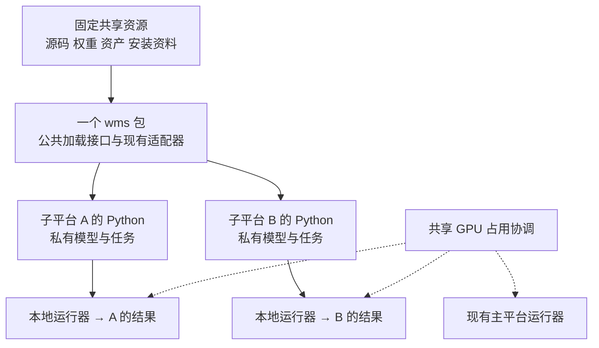

# WM SafetyLab 子平台开发定稿计划

日期：2026 年 10 月 14 日。状态：建议定稿，尚未实施。

本计划对照用户提供的《WM-SafetyLab 子平台开发计划.docx》、上一版共享资源方案以及当前代码整理。它替代上一版作为后续开发的推荐依据；本轮保留原文件，不改动正在开发的平台代码，不部署服务。

## 1 最终决定

采用“共享固定版本资源 + 一个轻量 Python 接口 + 各自的实验工作区”。首版以 Python 和本地 CLI 为入口，子平台自己安装依赖、创建模型与仿真实例、执行任务、保存结果。主平台运行服务不参与这些实验。

采纳 Word 计划的轻量接口与模板思路，保留上一版关于依赖重建、私有写入、共享版本和 GPU 协调的要求。接口实现继续复用现有 `wms`，不另行维护一套模型适配器、执行器或后端。

已经确认的约束不再重复征求意见：

- 子平台自建并管理 Python 环境，共享源码、权重和仿真资产。
- 第一阶段是可信内部团队，同一 Linux 账号下使用不同目录。
- 显式指定 GPU，首版遇到占用冲突明确拒绝；等待队列以后按需要增加。

首版交付标准是：组员从空工作区和空 Python 环境出发，能够调用已有模型、使用已有仿真环境、运行已有配方、增加自己的模型及任务，并把过程和结果完整留在自己的目录。

## 2 两版方案的取舍

| 比较项 | Word 计划 | 上一版方案 | 定稿处理 |
| --- | --- | --- | --- |
| 首版入口 | Python 接口、子平台脚本 | Python、CLI、独立 Web/API | 先 Python + 本地 CLI；Web 后续复用 |
| 接口代码 | 新建 `wms_provider` 与适配器 | 复用 `wms`，抽取公共加载函数 | 一个 `wms` 包，公开 `wms.components` |
| 执行器 | 新建 `sublab.run` | 复用现有 Runner | 新 CLI 包装现有 Runner/Store/worker |
| 已有任务 | 部分通过主平台 HTTP 运行 | 子平台自己的 worker 运行 | 配方在子平台本地执行 |
| 首批环境 | PushCube、圆心、PickCube、StackCube，多种观测 | 优先已有 TD-MPC2 与 ManiSkill 组合 | 两种 PushCube 任务、状态输入；RGB 录像 |
| 图像与位姿干预 | 首批提供遮挡、模糊、回合内移动 | 按研究需要扩展 | 首版一种状态观测扰动；位姿和视觉干预后移 |
| GPU 协调 | 最后阶段加锁 | 首批实际运行前解决 | 主子平台统一协作锁，冲突拒绝 |
| 依赖 | 每组件完整 freeze | 按经过验证的组合重建 | 安装 profile + 有效版本清单 + 空环境验收 |
| 只读边界 | 主平台目录只读、建用户组 | 发布资源只读使用、私有写目录 | 只约束已发布输入资源，不冻结主平台运行目录 |
| 验收 | 冒烟及开发种子 5/5 成功 | 环境、流程、扩展与隔离验证 | 分开检查接口正确性、完整流程、性能参考 |
| 训练 | 首版主要调用已有权重 | 首版加入小预算训练 | 训练教程和配方保留，首版不以重新训练收敛为关口 |
| 工期 | 1–2 人约 3 周，范围较宽 | 2 人 6–8 工作日，另加缓冲 | 缩减后的范围按 12–16 人日估算 |

Word 中“主平台不保存任务结果”和“通过主平台 HTTP 跑配方后取回结果”不能同时作为默认行为。HTTP 模式下任务仍由主平台排队、执行并产生记录，下载结果不会改变这一点。因此首版去掉这条路径；未来需要共享推理服务时，再作为单独的运行模式设计。

Word 中 `WMS_ROOT` 指向主平台的建议也需要修改。当前 `scripts/linux/use-linux.sh` 会用该变量创建缓存和临时目录。新工作区应明确区分自己的可写根目录与共享清单路径，不能把可写根指向主平台。

## 3 共享什么以及谁负责

| 资源 | 维护者提供 | 子平台负责 |
| --- | --- | --- |
| 框架 | 固定版本 `wm-safetylab` wheel、接口文档 | 安装指定版本，自主升级 |
| 上游源码 | 固定 commit 的干净 checkout 或发布副本 | 修改时建立私有副本，不改共享 checkout |
| 模型 | 固定权重、配置、状态和动作说明 | 在自己的进程与显存中加载，新增权重写自己目录 |
| 仿真 | 仿真器版本、资产、任务定义和适配器 | 安装依赖，创建独立 scene、机器人和随机状态 |
| 安装 | 已验证组合的安装脚本和 requirements | 建自己的 venv，维护额外依赖 |
| 配方 | 可选导入的组件登记和参考任务 | 参数覆盖、私有模型、私有任务及指标 |
| 数据 | 明确发布的只读参考数据集 | 采集数据、实验日志、训练权重和视频 |
| GPU | 统一协作锁与使用规则 | 选卡、申请占用、结束后释放 |

“共享模型”不等于共享已加载的 GPU 实例。两个子平台各自加载相同权重，通常仍各自占用显存。“共享仿真环境”也不等于共同操作一个运行中的环境。

同账号方案用于协作隔离，不是权限沙箱。不要把整个主平台目录改为只读，否则会影响它自己的任务、数据库与日志。可将固定发布文件设为只读以减少误写；同账号用户仍可能修改权限，因此还需要发布约定和实际写入检查。

## 4 推荐结构



```text
同一 Linux 主机
│
├─ 现有主平台                         保持服务和历史数据
│    └─ 维护、验证、发布共享组件
│
├─ shared/releases/<release>/          固定发布，按只读使用
│    ├─ wm_safetylab-<version>.whl
│    ├─ catalog.json                   指向固定源码、权重、资产
│    ├─ registry.json                  可运行组件和参考配方
│    ├─ profiles/                      安装说明及版本清单
│    └─ templates/                     新模型、新任务、工作区模板
│
├─ coordination/gpu-locks/             主子平台共用，可写
│
└─ workspaces/
     ├─ team-a/
     │    ├─ workspace.toml
     │    ├─ .venv/                   首个兼容组合使用一个环境即可
     │    ├─ envs/                    有第二种依赖组合时再增加
     │    ├─ registry.json            私有扩展
     │    ├─ configs/                 私有解释器和共享资源引用
     │    ├─ src/team_a/              模型、环境扩展、任务、指标
     │    ├─ datasets/
     │    ├─ data/                    现有 Store 格式与运行产物
     │    ├─ cache/
     │    ├─ tmp/
     │    └─ logs/
     └─ team-b/                       同样独立
```

建议在服务器现有 `/home/suzhenjie2026/world-model/` 下新增 `shared/`、`coordination/` 和 `workspaces/`。保留现有部署、仓库、环境和结果目录；清单可引用现有固定资源，无需整体搬移。

`catalog.json` 保存组件版本、资源来源、能力和已验证组合；`registry.json` 沿用当前运行格式，保存入口和配方。两者用途不同，但同一个入口、参数和资源路径只维护一份，另一份使用引用或在发布时生成。不要再建立第三套组件注册机制。

工作区配置至少包含：`workspace_root`、`shared_catalog`、显式加载的 registry、工作解释器、GPU UUID、锁目录。拟新增环境变量使用 `WMS_WORKSPACE_ROOT` 和 `WMS_SHARED_CATALOG`；旧 `WMS_ROOT` 继续表示可写根，或由新配置显式映射到私有目录。

## 5 Python 接口和本地运行方式

### 5.1 只增加一层公共入口

在同一个发行包中增加 `src/wms/components.py`，公开：

```python
list_components(catalog)
make_env(component_id, *, catalog, config=None)
load_model(component_id, *, catalog, config=None)
```

函数从当前 Python 环境中加载对象，按需导入实际引擎。列组件不导入 Torch、ManiSkill 等原生依赖。加载接口不自动切换解释器，也不向主平台发送请求。

不用再单独维护 `wms_provider` 发行包。如果团队以后确实需要这个导入名，可以做薄的重新导出，不能复制模型实现。

以下为拟实现的任务函数主体片段，当前尚不能直接执行。正式实验由工作区 CLI 启动，并在已经取得 GPU 占用的 worker 中执行；此片段本身不负责取得锁：

```python
from wms.components import load_model, make_env

# 本脚本在子平台自己的 Python 中运行。
catalog = "/home/suzhenjie2026/world-model/shared/releases/r1/catalog.json"
env = make_env("maniskill-pushcube-center-state@1.0", catalog=catalog,
               config={"runtime_config": "configs/tdmpc2.json"})
model = load_model("tdmpc2-pushcube-center@1.0", catalog=catalog,
                   config={"runtime_config": "configs/tdmpc2.json"})
try:
    for seed in [1100, 1101]:
        obs = env.reset(seed=seed, inputs={})
        model.reset(seed=seed)
        while True:
            action = model.act(obs)
            transition = env.step(action)
            obs = transition["obs"]
            # 在这里记录 action、transition 和当前渲染帧。
            if transition["terminated"] or transition["truncated"]:
                break
finally:
    model.close()
    env.close()
```

此例保留当前环境 `reset → observation` 和 `step → transition dict` 的调用约定。不会把所有已有适配器突然改成 Gymnasium 的 tuple 返回值。将来兼容 Gymnasium 环境时，转换在该环境适配器中完成。

### 5.2 按能力声明接口

| 对象 | 首版约定 | 可选能力 |
| --- | --- | --- |
| 环境 | `reset(seed, inputs)`、`step(action)`、`close()`、`spec()` | `render()`、诊断状态、受支持的任务干预 |
| 控制策略 | `act(observation)`、`spec()`、`close()` | 有跨步状态时提供 `reset(seed)` |
| 世界模型 | `predict(request)`、`spec()`、`close()` | `act`、`generate`、记忆重置等 |
| 完整任务 | 沿用 `run(config, output_dir, context)` | 采集、训练、规划、更新和独立评价流程 |

模型只实现自己有的能力。小型状态 WM 可以只有 `predict`，无需伪造 `act`。TD-MPC2 的 `predict` 返回潜变量和奖励预测，不能直接算方块位置误差；要评价物理位置预测，应使用有相应输出定义的模型或另行训练并验证的读出器。

`spec()` 采用简单字典，记录观测字段及顺序、shape/dtype、单位/坐标系、动作控制模式与范围、频率、回合时域、输出表示、可用相机、能力和已经验证的配对。暂不引入大型 Schema 或兼容性推理引擎。运行前只核对必要的任务、观测布局和控制器是否匹配。

特别注意：当前 TD-MPC2 使用完整状态和归一化 `pd_joint_delta_pos`，现有小型状态 WM 的采集流程使用另一套状态及 `pd_joint_pos`。这两套数据与动作不能仅按维数拼接。首版分别登记输入布局及控制器，使用各自已经验证的路径。

### 5.3 已有配方和自定义任务都在子平台执行

拟新增 `wms workspace run`，负责读取工作区配置、解析配方、选择 GPU、调用现有 Runner 并等待结果。GPU 锁统一由公共 Runner 在启动 worker 前取得，CLI 不重复加锁。原有 `wms run` 的 HTTP 语义保持不变，避免旧用户命令行为突然变化。

```text
子平台本地 CLI
  → 当前 Registry 解析选中的配方与私有 runtime
  → 当前 Runner 和子平台自己的 Store
  → 指定的子平台 Python 启动 unified worker
  → 本进程加载模型与环境
  → 写入子平台 data/runs/<id>/output
```

复用现有超时、取消、日志、独立评价和产物记录。首版不需要运行 HTTP 服务，不新增 Web 项目，也不再实现 `sublab` 执行器。现有 SQLite 仅作为子平台自己的本地运行记录，不建设新的数据库服务。

一个工作区同时只允许一个活动 Runner。占用锁必须在 Runner 启动恢复之前取得，否则另一个 CLI 可能把仍在运行的任务误标为中断。两个成员并行实验应使用两个工作区。未来增加工作区服务时，也须遵守相同的单实例规则。

直接 Python 调用适合交互调试；正式留档任务推荐通过本地 CLI 启动。直接调用不会天然获得完整任务日志、取消管理或 GPU 占用，必须由工作区启动工具/上下文提供这些功能。

## 6 首版范围与后续范围

### 6.1 首版必须完成

| 组件或功能 | 首版交付 | 验证边界 |
| --- | --- | --- |
| ManiSkill PushCube | 官方 `PushCube-v1` 和自定义 `WMS-PushCubeCenter-v1` | TD-MPC2 对应状态、控制器、任务配置；单环境 |
| TD-MPC2 | 两套已有任务权重的加载、reset、act、latent predict | 逐一验证各自匹配环境，不交叉套用 |
| 状态世界模型 | 从已有 checkpoint 恢复网络与归一化，提供独立 predict 适配器 | 用匹配的已有采集数据复验；不宣称能直接控制机械臂 |
| 图像证据 | 仿真 RGB 录像及帧与步骤对应关系 | 录像只是证据，不把状态模型称为视觉模型 |
| 一种实验干预 | 对明确字段施加一种状态观测噪声，提供无干预对照 | 污染模型输入，不修改评价真值 |
| 扩展模板 | 一个私有模型示例和一个完整自定义任务 | 增加扩展无需改共享核心 |
| 运行基础 | 私有 venv、资源目录、日志、GPU 冲突拒绝、本地 CLI | 主平台与两个工作区互不覆盖数据 |

`maniskill-pushcube-center-state@1.0` 可以作为公共组件 ID，但其绑定的实际任务 ID 必须是 `WMS-PushCubeCenter-v1`。Word 中的 `PushCubeCenter-v1` 不能直接当现有任务名使用。

### 6.2 首版之后按需求接入

1. PickCube、StackCube 及对应可用策略；再扩展 RGB/RGB-D 观测。
2. 指定任务中的 `set_goal`、物体位姿干预、外力干预，逐项验证。
3. 真实视觉策略的遮挡与模糊实验；状态执行器的图像处理演示单独标注。
4. 子平台训练、后训练、私有权重回载及发布流程。先使用小预算验证更新链路，再安排收敛训练。
5. OpenVLA、Dreamer、RLVR、Wan 等按实际任务增加独立 profile 和适配器。
6. 复用现有只读 Web，增加工作区标识；必要时增加跨环境模型进程桥。

不把所有模型统一归为 `predict`，也不承诺它们都可连接 ManiSkill。视频生成、语言预测、隐状态预测和动作控制仍各自保留能力及输出类型。后续模型工作量须在一次资源/接口试跑后估计，不能统一承诺每个 2–4 天。

## 7 安装与资源管理

### 7.1 按可运行组合提供安装资料

先交付 `tdmpc2-maniskill` 这一组 profile，再按需要拆分。每份包括：

- Python 版本、安装脚本、明确来源的 requirements/constraints。
- PyTorch wheel 的 CUDA 版本和安装源，以及驱动、Vulkan、PhysX 等系统条件。
- 固定上游 commit、资源定位方式、所用任务/控制器/观测定义。
- 从空环境重建的方法、短运行命令、一次完整回合的记录。
- 重建成功后导出的有效依赖清单；平台依赖也包含在内。

`pip freeze` 是环境记录，不等于可移植安装方案。不要把某个旧环境内的全部路径、editable 引用和隐式继承原样当成 requirements 发布。

当前 TD-MPC2 安装脚本通过 `.pth` 借用另一个 ManiSkill 环境的 site-packages。该方式可以保留给旧平台使用，但不满足“子平台自己安装和管理环境”的验收；必须在空 venv 中安装完整依赖，确认关键包确实来自子平台。

### 7.2 所有运行时写入都属于子平台

HF、Torch、pip、uv、CUDA、Triton、编译缓存、临时文件、matplotlib 配置和 `imgui.ini` 均指向私有路径。共享资源缺失时报告缺失项，由维护者补齐发布，或明确下载到子平台私有资源目录。

当前 TD-MPC2 的 `imgui.ini` 路径位于 PhysX 库旁，必须改成可配置的私有路径。不要仅修改任务输出目录而忽略缓存和渲染配置。

优先安装固定 wheel。需要构建上游代码时，在私有 staging 副本中构建或安装维护者发布的 wheel；不要对共享源码执行 editable 安装。缓存节省磁盘空间属于安装优化，不承诺所有依赖均能跨环境硬链接共享。

### 7.3 版本与清单

组件采用 `name@version`，记录 source commit、权重文件及来源、配置、接口版本和安装 profile。版本发布后不覆盖资源文件；主平台工作目录继续迭代时，已经发布的组件仍指向固定 checkout/快照。

首版不增加每次运行读取大权重做哈希的流程。可用名称、版本、commit、文件大小等记录来源；这不能检测所有静默覆盖。将来需要正式论文发布的强一致性证据时，可增加发布时的一次性校验，独立于日常运行。

## 8 GPU 与进程边界

首个多人 GPU 验收前，主平台和子平台都必须使用同一个协调目录。只给子平台加锁而主平台继续任意使用 GPU，不能解决争用。

首版流程：选择 GPU UUID → 非阻塞取得单卡占用锁 → 启动 worker → 持有到 worker 及本任务子进程结束 → 释放。冲突时返回占用信息与明确错误，不偷偷切到另一张卡。

锁可以使用 Linux 原生文件锁配合少量占用元数据。需要覆盖持锁进程异常退出后 worker 仍存活的情况：不能仅因锁文件/控制进程消失就认为 GPU 空闲；核查本任务进程身份，完成清理后才能重新分配。首版验证正常完成、取消和异常退出三条路径。

`CUDA_VISIBLE_DEVICES` 只负责可见设备映射。启动后记录逻辑设备与物理 UUID，并验证 Torch、PhysX 和 Vulkan 使用同一指定设备。无法满足时明确拒绝该组合；涉及第二张 GPU 的运行和多卡协调留到后续，不因申明了设备就视作已取得占用。

该规则约束遵守约定的运行入口，不是系统级 GPU 隔离。手工绕过入口启动的实验需要团队遵守相同占用约定。暂不建设集群调度、多卡调度或常驻模型服务。

## 9 实验记录与研究有效性

复用现有运行目录结构，补充过程记录：

```text
data/runs/<run_id>/
├─ config.json                已解析的任务与私有 runtime
├─ run.log                    worker 日志
└─ output/
   ├─ result.json             现有运行结果格式
   ├─ provenance.json         组件、资源、种子、解释器与 GPU
   ├─ steps.jsonl             按步记录，避免一次塞入 result.json
   ├─ summary.json            任务和评价汇总
   ├─ frames/                 需要时分段保存原图与策略输入
   └─ video.mp4
```

运行记录至少保留：组件版本、各组件源码 commit、checkpoint 来源、任务与控制器、模型输入布局、参数、环境种子、策略种子、扰动种子、工作区代码版本/修改状态、实际 Python 与依赖快照引用、GPU 及输出位置。

每步记录应区分 `observation_raw`、`observation_used`、`action_proposed`、`action_applied`、评价真值与事件。大数组可以保存为文件引用；相机帧按回合或块保存，不强制全部驻留内存。帧 0 对应初始状态，动作 k 对应其前后状态，视频中明确时序。

首个扰动示例固定任务、权重、初始条件与运行时域，比较无扰动和有扰动的配对回合。随机数流分别记录，避免开启噪声后顺带改变规划器的随机候选。报告成功率、最终位置误差和相关轨迹，保留失败样本。

视觉鲁棒性必须由实际读取图像的策略来验证。只给状态策略旁边的录像加遮挡，只能验证记录与处理流程。以后测试视觉策略时，记录它最终接收的图像；用于评价的仿真真值不能无意中传给策略。

回合内移动目标时，需明确干预发生在动作前还是后、观测与奖励/成功判据如何同步变化、剩余时间是否固定。移动物体还需要说明是瞬移还是物理作用，以及如何处理速度。这些能力先针对具体任务实现，不声明一个 `set_object_pose` 已适用所有仿真任务。

任务成功不等于安全。没有测量的碰撞、力、关节约束等字段应记录为未测量；不能默认 `false`。六阶段与安全研究标签可以作为记录元数据：数据与观测 S1、状态/动力学 S2–S3、评估规划 S4、执行反馈 S5–S6。失效、攻击、防护、评测只有在具体任务实际实现后才登记为已覆盖。

## 10 需要修改的代码范围

以下是实施任务清单，不表示本轮已经完成。

| 文件或模块 | 现有基础 | 本次拟做 |
| --- | --- | --- |
| `src/wms/components.py` 新增 | worker 内已有组件构造 | 抽取共享构造函数，公开三个加载入口，按需导入 |
| `src/wms/core/workspace.py` 新增 | 尚无统一工作区配置 | 定位私有路径、选择清单和 runtime、工作区占用 |
| `src/wms/core/registry.py` | 支持外部清单，自动发现默认配方 | 增加关闭默认发现选项，工作区显式路径基准 |
| `src/wms/core/resources.py` 新增 | 当前每实例只有自己的 FIFO | 单机 GPU 占用与释放、明确冲突信息 |
| `src/wms/core/runner.py` | 已有超时、取消、进程清理 | 接入协作锁；工作区模式不注入主平台源码/旧环境路径 |
| `src/wms/runners/unified.py` | 组件工厂、native 任务、统一产物 | 复用公共工厂；按能力处理每回合模型 reset 与种子 |
| `src/wms/app/cli.py` | CLI 当前任务提交走 HTTP | 增加无 HTTP 的 `workspace run`，复用现有执行逻辑 |
| `src/wms/core/protocols.py` | 按任务实现接口 | 补充能力和 spec 文档，保持现有 reset/step 兼容 |
| `src/wms/engines/tdmpc2/adapter.py` | 已有 reset、act、latent predict | 补足 spec、回合复验与所需诊断/渲染入口 |
| `src/wms/engines/tdmpc2/compat.py` | 已有专用状态环境 | 私有 imgui 路径；保持控制器与时域语义 |
| `src/wms/engines/state_wm_maniskill/adapter.py` 新增 | 已有采集/训练，predict 仍在训练内部 | 提取 checkpoint 推理加载，恢复归一化和输出定义 |
| 发布目录与 `profiles/` | 配方和机器配置已有 | 固定资源清单、空环境安装说明及运行模板 |
| `templates/`、`docs/`、必要测试 | 已有教程可复用 | 新模型、自定义任务、配对扰动和首批验收说明 |

当前 `ModelAdapter.reset` 已经存在于 TD-MPC2 适配器中，不能把它列为从零开发；需要补的是 worker 中的回合调用约定及复验。当前状态 WM 的内部训练预测函数则确实还不是对外的独立加载接口。

`core/storage.py` 继续使用，不重新设计；Web/API 首版不增加新页面或服务。原来的主平台启动方式保持兼容，子平台选择显式工作区模式。

## 11 开发阶段与合作分工

两名研发建议分为 A 平台接口负责人、B 模型仿真负责人。A 维护公共运行链路，B 维护已验证组合；互相审查交界处，不让两人分别实现一套加载器或 Runner。

| 阶段 | 主要交付 | 负责人 | 估计工作量 | 退出条件 |
| --- | --- | --- | --- | --- |
| P0 固定资源和范围 | 确定任务、权重、两套状态/动作语义、目录、profile 与公开 API | A+B | 1–2 人日 | 清单区分已验证、待适配和延期项；冻结首个配对 |
| P1 独立环境与运行边界 | 空 venv 重建、私有缓存、wheel、工作区/GPU 锁 | B 主环境，A 主运行 | 4–5 人日 | 真实 reset/step/渲染通过；GPU 冲突可拒绝 |
| P2 公共接口和本地任务 | components、专用 Env、TD-MPC2、状态 WM predict、本地 CLI | A+B | 4–5 人日 | 通过公共入口分别完成 TD-MPC2 回合和状态 WM 离线预测 |
| P3 模板与交叉验收 | 私有新模型/任务、状态扰动示例、过程记录、文档、主平台回归 | A 主模板，B 主实验 | 3–4 人日 | 非开发者按说明独立跑通；旧平台无回归问题 |

合计约 12–16 人日。两人部分并行，建议安排 8–10 个工作日，另预留 2–3 个工作日处理安装或渲染兼容问题；一人建议按 3–4 周排期。前提是两套 TD-MPC2 权重、状态 WM 检查点及其原预测产物可取得。以上不包含重新训练模型收敛、视觉抓取、全部模型认证及跨环境 RPC。P1 空环境安装完成后依据实际耗时修正估算。

建议第一周完成资源冻结、空环境安装和第一条完整回合，第二周完成本地运行、扰动、模板和交叉验收。第三人若参与，负责独立安装、文档、视频检查与扩展示例，不再分出第三套公共框架。

协作继续使用日常 GitHub 仓库 `wm-safetylab-update`。按阶段建 issue 和小 PR：公共接口/运行、依赖与组件、模板与文档分开交付；双方共同维护 API 示例、profile 和验收记录。私有研究任务可放独立目录/仓库；发布共享组件时提交明确版本，由维护者复验后收录。

不默认安排每日 GPU 冒烟或自动 cron。CPU 接口检查可进入已有 CI；GPU 验证在组件发布、环境变更和明确触发时运行。全组件 smoke 必须按安装 profile 选择对应解释器；未安装或跳过要显式记录，不能算通过。

## 12 首版验收清单

1. 从空 venv 安装固定 wheel 与首个 profile；运行 `pip check`，记录实际解释器和关键模块来源，不引用主平台 site-packages。
2. 两个子工作区使用各自配置和结果目录；启动/停止其中一个不会恢复、清理或覆盖另一个及主平台的任务。
3. 同一工作区第二个活动 Runner 被明确拒绝；检查发生在旧任务恢复之前。
4. 主平台和子平台争用同一 GPU 时，后一方得到明确占用信息；完成、取消、异常退出后资源处理正确。
5. TD-MPC2 两个已有 checkpoint 分别在匹配任务运行至少 3 个完整回合，检查 50 步时域、控制器、动作范围、成功定义和视频。
6. 开发种子 1100–1104 用作回归参考，检查与原配置的差异；不把固定 5/5 当成唯一正确性门槛。另取未用于这次适配调整的种子检查完整流程，样本数和结果如实报告。
7. 状态 WM adapter 在已有匹配数据上复算预测，与原训练产物按预先约定的数值容差比较；不把 latent prediction 当物理位置。
8. 私有目录加入一个模型和一个自定义任务，调用已有环境并保存结果，整个过程不修改共享核心或上游 checkout。
9. 无扰动/有扰动配对示例保存实际输入、实际动作、真值、扰动配置和可播放视频。第一版是工具与流程验收，不由少量回合推出安全结论。
10. 共享源码和资源无意外更改，所有缓存、配置、训练/评价输出属于工作区；运行报告写到私有或维护者指定的报告目录，不能写回只读发布目录。
11. 当前主平台保留原有用法，并完成针对本次改动的回归；发布失败可继续使用之前版本，不强制所有工作区同步升级。
12. 一位未参与开发的成员在依赖下载资源可用的前提下，按文档半天内完成已发布组合的安装与首条实验；遇到的每一步人工补丁回填安装脚本。

只有完成这些验收后，才把该 release 标为可供团队使用。5 步 smoke 只证明基础加载/调用，不能替代完整回合；任务成功和模型精度则需要独立研究协议。

## 13 后续扩展的进入条件

| 扩展 | 开始之前必须具备 |
| --- | --- |
| PickCube / StackCube | 任务与控制器配置，实际可运行的参考策略，一回合结果和安全信号说明 |
| 视觉鲁棒性 | 策略实际使用 RGB/RGB-D，原图与模型输入可区分，评价真值独立 |
| 回合内目标/物体移动 | 任务状态、观测、奖励、成功判据同步规则和可回放记录 |
| 训练/后训练 | 私有数据、明确更新目标、checkpoint 保存/回载、训练与测试划分 |
| 跨 Python 在线组合 | 一个真实依赖冲突案例，消息格式、超时、reset/close、进程清理验证 |
| 子平台网页 | Python/CLI 已稳定，确定需要浏览的运行记录和端口；复用现有 Web |
| 新组件进入共享清单 | 固定版本、可重建 profile、能力/spec、真实配对记录、维护责任人 |

没有必要再确认整体架构。实施时只需落实可用 GPU UUID、首个工作区目录、具体发布权重以及 A/B 负责人。PickCube、StackCube、Web 和跨环境服务先列后续，不应阻塞首批交付。

## 附录 核对依据和当前状态

本轮完整读取了 Word 正文中的 57 个段落和 6 张表，并查看了其架构图，结合上一版方案核对了当前本地代码。未重新连接服务器或运行 GPU 实验；不将历史主平台记录当成子平台已经验证成功。

原始材料：

- 用户文件：`C:/Users/hhh/Desktop/WM-SafetyLab 子平台开发计划.docx`。
- 上一版：`K:/world-model/deployments/wm-safetylab/docs/SUBPLATFORM_SHARED_RESOURCES_PLAN_20261014.zh-CN.md`。
- 当前代码：`K:/world-model/deployments/wm-safetylab/src/wms/`。
- 文本核对记录：`K:/world-model/deployments/wm-safetylab/results/subplatform-plan-review-20261014/source-plan-extracted.txt`。

主要核对点：`Registry` 的默认发现与路径基准；`Runner` 的启动恢复、解释器和 PYTHONPATH；`UnifiedWorker` 的组件构造与 reset；TD-MPC2 的 reset、状态环境和 latent 输出；状态 WM 的内部训练预测函数；`use-linux.sh` 的可写目录路由。

目前能够确认的是现有代码具备可复用基础；新的公共接口、独立 profile、工作区 CLI、共享 GPU 协调和子平台真实验收仍是待完成的开发工作。
