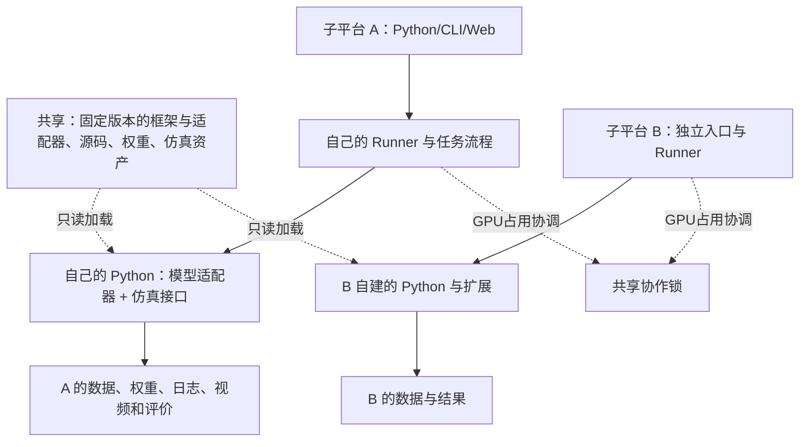

# WM-SafetyLab 子实验平台开发计划

日期：2026-10-14。状态：设计稿；已核对当前代码，尚未实施本方案或在新子平台复验模型。

## 1. 结论与已确认选择

方案可行。推荐形态为“共享固定版本的资源与框架，各自运行独立的实验工作区”。子平台复用已有适配器，直接在自己的 Python 工作进程中读取共享源码、权重和仿真资产；主平台 Web/API 不参与子平台每一步推理或仿真调用。

本轮已确认：

1. 子平台自建环境，共享源码、权重和资产，按需求安装依赖。
2. 第一阶段为可信内部团队，在同一 Linux 账号的不同目录运行。
3. 显式指定 GPU，冲突时排队或拒绝；首版建议拒绝并说明占用者，后续可在子平台本地排队。

“提供仿真环境”具体指仿真器版本、资产、任务定义和适配器。每次运行仍由子平台创建独立的仿真实例，不共用活动中的 scene、robot、状态或 RNG。多个子平台读取同一权重不会共享 GPU 中的模型实例，也不会自动节省显存。

## 2. 共享与私有边界

| 内容 | 主平台/维护者提供 | 子平台负责 |
| --- | --- | --- |
| 平台与已有适配器 | 固定版本 wm-safetylab wheel、源码版本、构建好的 Web | 安装选定版本；自行决定何时升级 |
| 模型资源 | 干净且版本固定的上游源码、已验证权重、模型说明 | 自己的运行配置、依赖、新模型与实验改动 |
| 仿真资源 | ManiSkill 等版本、机器人/场景资产、PhysX 库路径、已验证任务 | 自己创建环境实例、配置种子/控制器、增加场景 |
| Python | 按组合提供完整安装清单和已验证 Python/CUDA 条件 | 自建 venv，安装依赖，保存自己的有效版本清单 |
| 配方与接口 | 可选择导入的公共注册表、模型/Env/原生任务接口 | 私有注册表、指标、自定义任务流程 |
| 数据与输出 | 可选的只读数据集和明确发布的参考检查点 | 数据库、采集数据、训练权重、日志、视频和结果 |
| 缓存 | 可选只读下载资源/轮子仓库 | 可写 pip/HF/Torch/Triton/编译/仿真缓存及临时文件 |
| GPU | 同一套协作占用规则和锁目录 | 显式选择设备，遵守占用规则 |

已有主平台目录不搬移、不清空。新增 shared catalog 只记录原资源绝对路径和版本。需要正式发布的训练检查点可由维护者复制或发布为固定路径，不以主平台 run ID 充当全局模型 ID。

同账号的目录和 venv 主要隔离依赖与结果，不构成不可信代码的权限沙箱。共享资源按只读使用，可用文件权限防止意外写入；软链接本身不提供只读保证。后续若要强制隔离不同成员，再采用独立账号或容器权限。

## 3. 推荐目录和运行关系

以下都是建议路径，实施前确认空间、实际资源位置及端口占用：

```text
/home/suzhenjie2026/world-model/
├── deployments/wm-safetylab/       # 现有总平台，保持现有环境和数据
├── repos/                         # 现有上游源码，固定版本
├── weights/                       # 示意：实际权重可仍在原位置
├── assets/                        # 现有仿真资产
├── shared/
│   ├── releases/<version>/        # 固定版平台 wheel 和 web/dist
│   ├── catalogs/<version>/        # 资源说明、公共 registry、原生配置模板
│   └── profiles/                  # 安装清单、系统依赖说明、已验证组合
├── coordination/gpu-locks/        # 协作锁，独立于只读模型资源
└── workspaces/
    ├── team-a/
    │   ├── workspace.toml         # 私有根目录、目录清单、端口等
    │   ├── .venv/                 # 平台控制/API/CLI 环境
    │   ├── envs/tdmpc2-maniskill/  # 本人的完整原生工作环境
    │   ├── envs/new-model/         # 需要不同依赖时再建
    │   ├── requirements/          # 用户自己的约束与锁文件
    │   ├── configs/               # 指向私有 Python、共享只读资源
    │   ├── registry.json          # 私有模型、环境、算法、配方和指标
    │   ├── src/team_a/            # adapters、tasks、metrics、scenarios
    │   ├── data/                  # runs.sqlite3 + runs/<id>/output
    │   ├── datasets/              # 用户采集的数据
    │   ├── cache/                 # 所有可写缓存
    │   ├── tmp/
    │   └── logs/
    └── team-b/                    # 独立环境、端口与数据
```

单个兼容组合也可以先共用子平台自己的一个 venv；拆成服务环境与原生环境是为了避免多模型依赖冲突，并非必须为每个任务新建一个环境。



Linux 服务端口示例：主平台8765、A为8771、B为8772。各自前后端同源；用户电脑用不同 SSH 转发端口访问。端口号不是模型身份或资源位置。

## 4. 接口和四种使用方式

继续保留一个 wms 发行包。已有组件实现按需的方法；无需把所有模型改成相同内部表示。

| 使用方式 | 当前接口基础 | 子平台需要写的内容 |
| --- | --- | --- |
| 运行现有任务 | recipe + `task: native/predict/rollout/plan/generate` | 私有 runtime，输入和参数覆盖 |
| 新模型使用已有仿真 | `ModelAdapter(config)`、`predict`/`act`，`Env.reset/step/close` | 新模型适配器、依赖清单、注册表；核对动作和观测语义 |
| 新仿真使用已有模型 | 同上 | Env 适配器、任务定义、状态/动作转换与真实验证 |
| 自己写完整实验 | `run(config, output_dir, context)` 原生函数 | 自定义采集、训练、反馈更新、防护及评价流程 |

计划提供两个小型公共加载入口 `wms.components.load_model(...)` 和 `load_environment(...)`，从现有 UnifiedWorker.component 抽取公共逻辑，不新增多层 Factory/Service。这两个函数是拟开发功能，当前还不能直接调用。它们只创建当前 Python 中的对象，不自动切换解释器或发送远程请求。

公共约定：

- 模型只声明并实现自己支持的 generate、predict、act；支持在线记忆的模型需说明回合重置方式，运行 seed 显式传入。
- 环境保留 reset(seed, inputs)、step(action)、close；step 返回 obs/reward/terminated/truncated，可选 events/cost/info。
- 状态、潜变量、视频、语言预测保留各自类型；输出和控制器匹配由适配器承担。
- 当前 TD-MPC2 状态输入与 pd_joint_delta_pos 组合不能直接换成普通 PandaPushCubeEnv 的 pd_joint_pos；即便动作都是8维也不等价。第一条正式组合使用现有 TD-MPC2 专用 EnvironmentAdapter。
- 一次普通 worker 中的模型、环境和规划器共用一个解释器。若两个依赖栈不能共存，先建一个明确的进程通信适配器再开放组合；首版不承诺任意模型与仿真器可自由拼接。
- 自定义 native 函数使用 output_dir/context 写入私有产物并响应取消。需要自己启动子进程时保留 WMS_RUN_ID/WMS_RUN_DIR 等运行标记。

新增模型仅需新增私有模块和注册项；不要改公共引擎分发器。新任务采用 team-a.* 等独立 ID。公共 ID 冲突仍明确报错；调整参数使用每次运行覆盖，而不暗中改掉公共基线定义。

## 5. 当前代码已支持与需要补齐的部分

| 位置 | 已有能力或实际问题 | 本轮计划 |
| --- | --- | --- |
| `core/registry.py` | 支持外部注册表；但 PROJECT_ROOT 取源码安装位置，并自动扫主项目配方 | 增加明确 workspace_root、公共catalog清单和默认发现开关；子平台只载入显式选择的清单，主平台保留原用法 |
| `app/cli.py`、`app/api.py` | storage_root、worker_python、native_configs 已存在；API 可指定 web_dist | 新增工作区配置入口，把目录与网页路径透出；不要复制另一套后端 |
| `core/runner.py` | 支持每任务指定 Python、cwd、env；但继承服务 PYTHONPATH 且注入服务源码 | 工作区模式仅使用约定的框架版本和私有扩展路径，清理外层PYTHONHOME/PYTHONPATH/VIRTUAL_ENV；记录实际解释器与关键包来源 |
| `core/storage.py` | SQLite和文件已按 storage_root 隔离 | 保持；每个平台必须单独 root，同一个 root 仅允许一个活动服务 |
| `core/runner.py` 启动恢复 | 会清理本库未完成任务并标为 interrupted | 不能让子平台指向主平台数据库；增加轻量实例占用检查以防误配置 |
| `engines/runtime.py` 与各原生配置 | 原文件含机器路径、旧Python、GPU等；不是可直接共享的子平台配置 | 根据公共资源说明生成私有 runtime，只复用资源路径，不继承主服务运行环境与凭据 |
| `engines/tdmpc2/compat.py` | imgui.ini 写到 PhysX 库旁 | 新增私有可写路径，将仿真配置与共享库分开 |
| `native/tdmpc2/prepare_server.sh` | 当前通过 .pth 借用 ManiSkill base 的 site-packages | 新增独立环境构建流程；不把旧 overlay 当可迁移子环境 |
| `requirements.lock`、`pyproject.toml` | 当前根 lock 缺少声明依赖 psutil；原生 lock 也不等于系统依赖说明 | 从空环境重建并验证平台与各原生组合的完整清单，记录安装源和Python版本 |
| `runners/unified.py`、`core/protocols.py` | 已有组件构造和原生函数约定 | 抽取小型公共组件加载入口；明确seed、资源关闭和有状态策略的回合边界 |
| `web/` | 生产前端使用同源 /api/v1，适合独立端口 | 复用固定构建，只加工作区名/端口标识；开发代理地址可配置 |
| 拟新增 `core/workspace.py` | 当前没有整体工作区配置 | 负责配置解析、路径定位和环境启动参数，保持一个小模块 |
| 拟新增 `core/resources.py` | 各实例只有自己的FIFO | Linux单机GPU协作锁、占用信息与明确冲突错误，不引入调度集群 |

wheel 安装时 native配方、examples、web 并不自动出现在旧 PROJECT_ROOT 下。首版把公共catalog与Web作为独立、固定版本的发布资源，并在workspace配置中显式引用；开发和验收必须包含“安装wheel后运行”，不能只在editable源码目录验证。

## 6. Python、安装清单与缓存管理

维护者提供的是一组按组合拆开的、实际验证过的安装资料：

```text
profiles/
├── platform/requirements.lock
├── tdmpc2-maniskill/{requirements.lock, constraints.txt, install.sh, environment.md}
├── maniskill/{requirements.lock, install.sh, environment.md}
└── <other-validated-combination>/...
```

每个 profile 记录 Python版本、pip包版本与wheel来源、上游commit、资产版本、所需系统库、最小运行命令及验证范围。PyTorch CUDA wheel索引、系统NVIDIA驱动、Vulkan ICD、PhysX库及渲染条件单独记录；一个 requirements.txt 无法描述全部这些条件。

子平台从空 venv 构建，不引用主平台 envs/*/site-packages、不使用共享venv、不向共享上游执行editable安装。需要构建上游包时，使用发布wheel，或在子平台 staging 副本中构建再装入私有环境。用户需要修改源码时，在自己的目录保留分支/副本，不直接修改主平台资源。

HF_HOME、HF_HUB_CACHE、TORCH_HOME、CUDA_CACHE_PATH、TRITON_CACHE_DIR、TORCHINDUCTOR_CACHE_DIR、MPLCONFIGDIR、XDG_CACHE_HOME、PIP_CACHE_DIR、TMPDIR、imgui配置均落到子平台。系统运行库路径按profile明确传递，不为“隔离”一概清空所有系统环境变量。

共享权重和资产由维护者准备完整后发布；遇到缺失资源应给出缺失项和准备方式，不让子任务向只读共享目录下载。相同代码在新环境中重新运行可能有数值差异，记录版本和容差，不承诺逐位完全相同。

## 7. GPU、结果与已有检查点

GPU采用单机协作机制：明确设备UUID，获取该卡的锁后启动任务，运行期间持有，结束或取消后释放。首版冲突返回GPU_BUSY及占用运行；可随后增加本实例等待。不把 `CUDA_VISIBLE_DEVICES` 当显存隔离或资源预留。

主平台及所有子平台必须接入同一协作规则。绕过平台直接启动的进程不会被锁自动约束；系统GPU进程检查用于诊断，不能替代操作系统隔离。需要验证Torch、PhysX和Vulkan实际使用同一被分配的设备，不能只检查环境变量。首版支持单卡任务，其他情况明确报未支持。

每个子平台保存自己的数据库与产物。运行ID和 source_run 默认仅在当前子平台有效；不能直接用主平台 run_ID 访问子平台数据。复用主平台训练结果时显式指定发布的共享 checkpoint 路径和来源元数据。跨子平台评价先通过导出/导入标准证据完成，后续需要时再增加只读结果目录查询。

共享权重是输入，不登记为子平台新生成的工件。子平台训练出的新权重写自己 output，再由维护者决定是否发布进公共资源。报告型模块若目前需要同一Store的训练/评测目录，需使用子平台自己的训练记录，或另写明确支持外部参考检查点的报告；不伪造本地来源运行。

## 8. 开发阶段、分工和工期

估算前提：2名研发，现有Linux/4090和资源可用，首批只保证TD-MPC2＋ManiSkill及一个轻量新模型接入。预计6–8个工作日、约11–15人日；依赖重建或渲染兼容问题另留2–3个工作日缓冲。此估算不包含任意跨Python在线RPC、多机调度及全部模型逐个认证。

| 阶段 | 工作与交付 | 负责人 | 参考用时 | 验收关口 |
| --- | --- | --- | --- | --- |
| P0：固定边界和资源 | 确定共享资源版本、A/B目录、端口、任务组合、安装profile；不搬移旧资源 | 两人 | 0.5天 | 清单能区分输入资源、私有写入、系统依赖 |
| P1：工作区与发布 | workspace配置、独立发现、wheel安装、私有Store、生产Web复用、小型公共加载接口 | A | 2–3天 | 两个不同目录和venv的CPU工作区可运行自己的任务 |
| P2：独立原生环境 | 完整TD-MPC2/ManiSkill清单，私有缓存与imgui，公共资源路径/组件说明 | B，与P1并行 | 2–3天 | 空venv安装、pip check、关键包不来自主venv，真实reset/step/录像 |
| P3：资源协调与真实纵向流程 | GPU协作锁，指定共享检查点评测；小预算训练、私有权重回载、独立评价 | A+B | 1–2天 | 主子或双子冲突处理正常；新数据全部属于子平台 |
| P4：扩展验收与交付 | 新模型插件、复用旧Env、自定义native流程、用户教程、主平台回归 | A+B | 1–2天 | 新增模型/任务无需修改wms核心；两套实例互不误清理 |

A负责core/workspace、registry、runner、CLI/API、GPU协调与发布；B负责环境profile、资源目录、模型/Env适配和真实验证。若有第三人，负责私有扩展示例、网页工作区标识、接口手册与交叉验收，不再拆出第三套核心。

所有共享核心修改通过同一个日常仓库维护；子平台任务代码使用各自的目录/分支或仓库。共享接口变更先合入固定版本，再由使用者主动升级，避免主平台随手改源码使所有子平台同时变化。

## 9. 首批真实验收与交付标准

1. 两个空目录、两个私有Python和两个端口；A/B自己的注册表、数据库、日志、缓存均隔离。启动/停止B不改变A任务状态。
2. 从固定wheel运行，不依赖主源码checkout的相对目录；已有主平台旧启动方式仍通过回归。
3. 从空原生venv安装TD-MPC2＋ManiSkill；检查sys.executable、Python ABI、关键包__file__和pip check，不能从主venv借包。
4. 使用共享固定检查点，通过已有专用Env接口完成至少3个固定种子的50步真实回合，保存动作、状态、成功判据、视频及独立指标。这是接入验收，不据3回合声明模型能力或安全性。
5. 在子平台完成1600条转移的小预算训练，确认确有梯度更新；私有checkpoint在新worker回载并评测。这里只验证流程，不重新追求训练收敛。
6. 注册一个私有新模型，用已有环境完成实际一步和完整任务；再注册一个自定义native流程。新的模型和任务均只修改私有目录，不修改wms核心。
7. 共用GPU时按设定拒绝或等待；取消一个子任务不影响另一平台，且没有遗留本任务GPU进程。
8. 共享源码Git状态、权重和资产前后不变，所有可写内容归子平台；检查视频解码、数据链接和网页归属。
9. 首批交付：平台wheel+Web、公共catalog、可独立构建的profile、子平台初始化模板、已有接口手册、新模型和自定义流程教程、验收报告。

## 10. 与WM安全研究的关系及后续范围

子平台组织方式支持各组独立开展观测扰动、动力学失效、风险规划、执行防护或反馈更新，保留S1–S6及失效/攻击/防御/评测标签；它本身不会新增安全证明。

公共模型、Env、危险事件定义和指标版本尽可能固定。各组在私有任务中实现干预/防护，报告来源、任务表现和真实危险信号，缺测保留unknown。后续比较不同组的安全方法时，统一任务/权重/控制器/种子/危险判据，再显式导入证据，不能只因接口签名一样就直接排名。

后续按需求增加：更多已验证模型profile、模型与仿真的跨venv常驻进程桥、只读跨工作区结果聚合、独立Linux账号及更完整GPU队列。首版不需要Slurm/Kubernetes、平台间RPC或一个包含所有模型依赖的巨大环境。

本轮只完成代码核对与设计。三个关键选择已经确认；具体子目录名称和空闲端口可在实施时按模板确定，不需要再为整体架构重复确认。
